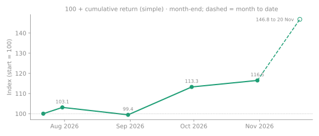
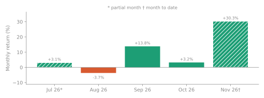

# Performance

> **Model portfolio**: the reference book for my trading. Decisions are published and
> timestamped in real time; live execution follows the same theses, though sizing and
> timing can differ. Results are gross and are not an account statement. Returns are
> **simple, not compounded**: % of starting equity, added across months (methodology §7).
> Rules: [methodology v1.2](methodology/v1.md) · Data to 20 Nov 2026 close · Built from commit `231c4fa`

| Index | Since inception | Max drawdown (month-end) | Max drawdown (daily) | Current drawdown | Closed / open |
|---|---|---|---|---|---|
| 146.78 | +46.78% | -3.68% (Jul 2026 → Aug 2026) | -12.02% (5 Nov → 11 Nov) | 0.00% | 4 / 1 |

Compounded equivalent of the same monthly returns: **+52.06%** since inception, for comparison with records that compound. Every other figure on this page is simple (methodology §7).

Inception 22 Jul 2026. Figures to 20 Nov 2026 include open positions at that day's close; month-end figures use completed months only. Drawdowns are in percentage points of starting equity.

*Month-end values, with the daily drawdown line for comparison (methodology §8).*

## Key statistics

| Returns (completed months, n = 4) | | Trades (closed, n = 4) | |
|---|---|---|---|
| Year to date | +46.78% | Trade win rate | 50% (2 of 4) |
| Best / worst month | +13.82% / -3.68% | Thesis hit rate | 100% (2 of 2 judged; 1 untested/open) |
| Positive months | 3 of 4 | Avg win / avg loss | +4.25R / -1.00R |
| Longest under water | 1 month | Payoff ratio | 4.25 |
| Return ÷ MDD (not annualised) | 12.7 | Expectancy | +1.62R |
| Avg / max risk per trade | 2.62% / 4.00% | Profit factor | 4.25 |
| Max notional exposure | 771% of equity | Best-trade share of total R | 73% (T002) |
| | | Avg hold, winners / losers | 21.5 days / 7.5 days |
| | | Longest losing streak | 2 |

*Annualised return, volatility, Sharpe, Sortino and correlation with the S&P 500 are withheld until 24 monthly returns exist (4 so far). See methodology §8.*

## Thesis × trade

|  | Trade won | Trade lost |
|---|---|---|
| Thesis confirmed | 2 (T002, T004) | 2 (T001, T003) |
| Thesis killed | 0 | 0 |
| Untested / open | 0 | 0 |

*Closed trades only. A confirmed thesis with a losing trade means the idea was right and the timing or sizing was not (methodology §9).*

## Monthly returns (%)

| Year | Jan | Feb | Mar | Apr | May | Jun | Jul | Aug | Sep | Oct | Nov | Dec | Year |
|---|---:|---:|---:|---:|---:|---:|---:|---:|---:|---:|---:|---:|---:|
| 2026 |  |  |  |  |  |  | +3.11* | -3.68 | +13.82 | +3.23 | +30.29† |  | **+46.78†** |

*\* partial month (from inception).*
*† to 20 Nov 2026 close, including open positions; not final.*
*Jul 2026, Aug 2026, Sep 2026, Oct 2026: backfilled on 2026-11-20, from public closing prices.*

## Open positions (at 20 Nov 2026 close)

| Trade | Thesis | Instrument | Entry | Stop | Close | Open R | Open % |
|---|---|---|---:|---:|---:|---:|---:|
| [T005](performance/theses/TH03.md) | TH03 | SPX | 7,773.07 | 7,861.50 | 6,910.39 | +9.76R | +39.02% |

*Unrealised. Counted in the month-to-date figure; never in trade statistics.*

## Theses

| Thesis | Trades | Closed R | Closed % | Verdict |
|---|---|---:|---:|---|
| [TH01 Term-premium ceiling test](performance/theses/TH01.md) | 2 | +3.75R | +5.60% | Confirmed |
| [TH02 SPX vol asymmetry](performance/theses/TH02.md) | 2 | +2.74R | +2.16% | Confirmed |
| [TH03 SPX Q4-2018 analog / AI capex](performance/theses/TH03.md) | 0 + 1 open | — | — | Open |

*Closed R and % are simple sums across the thesis's trades, not compounded.*

## Reports

| Period | Return | Worst month-end drawdown | Report |
|---|---:|---:|---|
| 2026-Q4 | +33.52% | 0.00% | In progress |
| [2026-Q3](performance/quarters/2026-Q3.md) | +13.26% | -3.68% | Frozen (backfilled) |
| 2026 | +46.78% | -3.68% | In progress |

Data: [registry](performance/registry.csv) · [month-end marks](performance/marks.csv) · [daily prices](performance/prices/) · [validation report](performance/VALIDATION.md)
