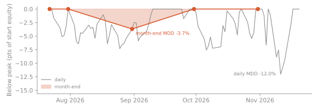
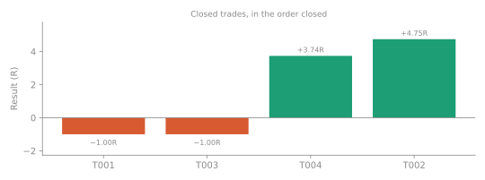
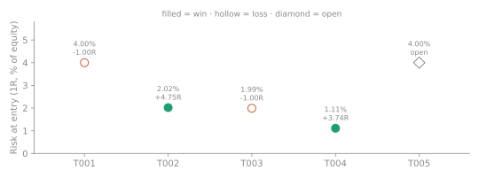

# MCMR · Model Portfolio

**Discretionary macro, published before the outcome.** Data to 20 Nov 2026 close · inception 22 Jul 2026

Model portfolio: every decision is published and timestamped in real time; results are simple (not compounded), gross, and not an account statement.

| Since inception | This month (to date) | Max drawdown | Win rate | Open positions |
|:---:|:---:|:---:|:---:|:---:|
| **+46.78%** | **+30.29%** | **−3.68%** | **50%** | **1** |
| simple · compounded +52.06% | Nov 2026 | month-end · daily −12.0% | 2 of 4 · wins avg 4.2× losses | listed below |

### Monthly returns (%)

| Year | Jan | Feb | Mar | Apr | May | Jun | Jul | Aug | Sep | Oct | Nov | Dec | Year |
|---|---:|---:|---:|---:|---:|---:|---:|---:|---:|---:|---:|---:|---:|
| 2026 |  |  |  |  |  |  | +3.11* | −3.68 | +13.82 | +3.23 | +30.29† |  | **+46.78†** |

\* partial month · † to 20 Nov 2026, includes open position; not final

### Open position

| Trade | Thesis | Direction | Entry | Stop | Last close | Open result |
|---|---|---|---:|---:|---:|---:|
| [T005](performance/theses/TH03.md) | SPX Q4-2018 analog / AI capex | Short SPX | 7,773.07 | 7,861.50 | 6,910.39 | **+39.02%** (+9.76R) |

Unrealised. Included in this month's figure, never in trade statistics.

### Reports

| Period | Return | Worst month-end drawdown | Report |
|---|---:|---:|---|
| 2026-Q4 | +33.52% | 0.00% | In progress |
| [2026-Q3](performance/quarters/2026-Q3.md) | +13.26% | −3.68% | Frozen (backfilled) |
| 2026 | +46.78% | −3.68% | In progress |

---

<b>Risk and statistics</b>

| Returns | | Trades | |
|---|---:|---|---:|
| Completed months | 4 | Closed trades | 4 |
| Best / worst month | +13.82% / −3.68% | Win rate | 50% |
| Positive months | 3 of 4 | Avg win / avg loss | +4.25R / −1.00R |
| Max drawdown, month-end | −3.68% (Jul 2026 → Aug 2026) | Payoff ratio | 4.25 |
| Max drawdown, daily | −12.02% (5 Nov → 11 Nov) | Expectancy | +1.62R |
| Current drawdown | 0.00% | Profit factor | 4.25 |
| Longest under water | 1 month | Best-trade share of total R | 73% (T002) |
| Return ÷ max drawdown | 12.7 | Avg hold, winners / losers | 21.5 days / 7.5 days |
| Avg / max risk per trade | 2.62% / 4.00% | Longest losing streak | 2 |
| Max notional exposure | 771% of equity | Thesis hit rate | 100% (2 of 2 judged; 1 untested/open) |

Returns and drawdowns are % of starting equity (simple). Annualised return, volatility, Sharpe, Sortino and S&P 500 correlation appear once 24 monthly returns exist (4 so far).

<b>Trades and theses</b>

| Thesis | Trades | Closed R | Closed % | Verdict |
|---|---|---:|---:|---|
| [TH01 · Term-premium ceiling test](performance/theses/TH01.md) | 2 | +3.75R | +5.60% | Confirmed |
| [TH02 · SPX vol asymmetry](performance/theses/TH02.md) | 2 | +2.74R | +2.16% | Confirmed |
| [TH03 · SPX Q4-2018 analog / AI capex](performance/theses/TH03.md) | 0 + 1 open | — | — | Open |

**Was the idea right, and did the trade pay?**

|  | Trade won | Trade lost |
|---|---|---|
| Thesis confirmed | 2 (T002, T004) | 2 (T001, T003) |
| Thesis killed | 0 | 0 |
| Untested / open | 0 | 0 |

<b>Method and data</b>

- **Model portfolio.** The reference book for my trading. Live execution follows the same theses, though sizing and timing can differ.
- **Simple returns.** % of starting equity, added across months. The compounded equivalent (+52.06%) is shown for comparison only.
- **Valuation.** Open positions at the official close: month-end marks for monthly figures, the latest daily close for this month.
- **Gross.** Transaction costs assumed negligible; futures carry not modelled.
- **Backfilled months.** Jul 2026, Aug 2026, Sep 2026, Oct 2026 were calculated on 2026-11-20 from public closing prices, after the fact; later months freeze at month-end.
- **Rules:** [methodology v1.2](methodology/v1.md). **Data:** [registry](performance/registry.csv) · [marks](performance/marks.csv) · [daily prices](performance/prices/) · [validation report](performance/VALIDATION.md). Built from data commit `e378ee0`.

